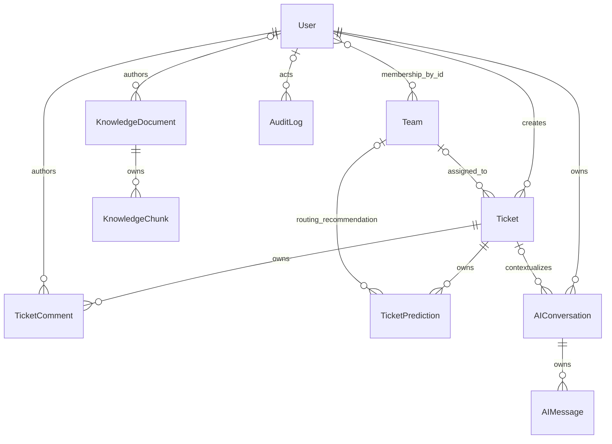

# Domain Layer — IT Ticket Intelligence

Le domaine utilise uniquement la bibliothèque standard .NET. Aucun package, référence projet, attribut de persistance ou service externe n’est ajouté à Domain.

## Identité et agrégats

Les entités principales et `KnowledgeChunk` héritent de `Entity` et possèdent une clé primaire logique `Guid Id` non vide, obligatoire et immuable. L’appartenance `TeamMember` utilise la clé composite `(TeamId, UserId)`. Les identifiants et les dates sont fournis par l’appelant : le domaine ne génère ni identifiant ni heure système.

Les racines sont `Ticket`, `User`, `Team`, `KnowledgeDocument` et `AIConversation`. Le ticket contrôle ses commentaires et prédictions ; la conversation contrôle ses messages. Les liens entre racines utilisent des identifiants, sans navigation mutable partagée. `AuditLog` représente un fait indépendant et immuable.

## Propriétés

Toutes les propriétés de la colonne « obligatoires » sont non nullables. `Id` est obligatoire pour toutes les entités et n’est pas répété.

| Entité | Propriétés obligatoires | Propriétés nullables |
|---|---|---|
| Ticket | Reference, Title, Description, CreatedById, Status, Revision, CreatedAt, UpdatedAt, IsArchived, Comments, Predictions | Category, Priority, AssignedTeamId, Resolution, ResolvedAt, ClosedAt, ArchivedAt |
| User | Name, Email, Role, IsActive, CreatedAt, UpdatedAt | Aucune |
| Team | Name, IsActive, CreatedAt, UpdatedAt, MemberIds | Description |
| TicketComment | TicketId, AuthorId, Message, CreatedAt | Aucune |
| TicketPrediction | TicketId, Type, Confidence, ModelVersion, InputRevision, CreatedAt, NeedsHumanReview | PredictedCategory, PredictedPriority, RecommendedTeamId, RecommendedTeamName, AnalysisId, ReviewThreshold : résultat typé et abstention cohérente |
| KnowledgeDocument | Title, Content, Source, Category, Kind, Format, Version, CreatedAt, UpdatedAt, Chunks | CreatedById, CleanedContent, ProcessingVersion, ProcessedAt |
| KnowledgeChunk | DocumentId, DocumentVersion, Position, Content, StartOffset, EndOffset, ContentHash, CreatedAt | Aucune |
| AIConversation | UserId, CreatedAt, UpdatedAt, Messages | TicketId : conversation générale si absent ; Title ; LastMessageAt |
| AIMessage | ConversationId, Role, Content, CreatedAt | ToolName et ToolCallId : tous deux requis pour le rôle Tool, absents pour les autres rôles |
| AuditLog | Action, EntityType, EntityId, OccurredAt | UserId : action système si absent ; Details ; CorrelationId |

Les collections sont initialisées vides et exposées en lecture seule. Les faits `TicketComment`, `TicketPrediction`, `AIMessage` et `AuditLog` n’exposent aucun setter.

Le [pipeline d'intelligence](ticket-intelligence-pipeline.md) regroupe trois prédictions avec `AnalysisId` et conserve leur seuil de revue. Category et Priority portent leur valeur typée. TeamRouting porte soit l'identifiant historique d'une équipe, soit un label du modèle ; dans ce dernier cas, le label est absent sous le seuil et `NeedsHumanReview` vaut true. Un label ML ne désigne pas une affectation réelle. Les prédictions historiques sans seuil ne portent aucune décision de revue enregistrée.

## Relations métier



`AuditLog.EntityType` et `EntityId` désignent logiquement la cible auditée. La relation n’est pas un graphe de navigation générique vers toutes les entités.

`Team.Members` contient les appartenances `TeamMember`, identifiées par la paire `(TeamId, UserId)` et datées par `CreatedAt`. `MemberIds` reste une projection en lecture seule, sans doublon. Un utilisateur peut appartenir à plusieurs équipes. Ce modèle reste indépendant de toute technologie de stockage.

L’existence et l’activité d’une équipe affectée et des utilisateurs référencés sont contrôlées par les cas d’usage Ticket Management. L’unicité globale des emails/références est garantie en persistance. Les autorisations seront ajoutées avec l’authentification. Une entité isolée ne peut pas vérifier les autres agrégats en base.

## Enums

- `TicketStatus` : Open, InProgress, Resolved, Closed.
- `TicketPriority` : Low, Medium, High, Critical.
- `TicketCategory` : Billing, Network, Hardware, Software, Account, Security, Database, Application, Other.
- `UserRole` : User, Agent, Admin.
- `PredictionType` : Category, Priority, TeamRouting.
- `AIMessageRole` : System, User, Assistant, Tool.

Les valeurs numériques non définies sont rejetées aux points d’entrée métier. Les équipes restent des entités et ne deviennent pas un enum figé.

## Value objects

- `EmailAddress` : email simple, valide, nettoyé et normalisé en minuscules ; pas de nom d’affichage ni de liste d’adresses. Égalité par valeur. La disponibilité de l’adresse et l’unicité entre utilisateurs ne sont pas vérifiées ici.
- `PredictionConfidence` : score numérique fini compris entre 0 et 1 inclus. NaN et les infinis sont interdits. Ce score ne prétend pas être une probabilité calibrée. La valeur par défaut du struct est le score valide 0.

Les identifiants et petits champs textuels ne reçoivent pas de wrappers supplémentaires à cette étape.

## Invariants du ticket

```text
Open ──StartWork──> InProgress ──Resolve──> Resolved ──Close──> Closed
                       ^                    |
                       └──────Reopen────────┘
```

- Création : statut Open, révision 1, classification et équipe absentes.
- Les transitions passent exclusivement par ces méthodes. Closed est terminal dans cette version.
- `Resolve` exige une explication non vide. `Reopen` efface la résolution et la date de résolution courantes.
- Description, classification et affectation ne peuvent être modifiées que pour Open ou InProgress.
- Un commentaire peut être ajouté à un ticket résolu, mais pas à un ticket fermé.
- L’archivage est indépendant du statut : il bloque toute modification jusqu’à restauration, sans effacer l’historique ni réouvrir un ticket fermé. Archiver/restaurer incrémente la révision uniquement si l’état change.
- Un commentaire doit cibler ce ticket, avoir un identifiant inédit et une date qui ne précède pas la dernière modification.
- Toute modification métier du ticket, commentaire compris, incrémente sa révision. Les prédictions n’incrémentent pas la révision et n’appliquent pas leurs recommandations.
- Une prédiction historique peut être conservée, mais pas une prédiction ciblant une révision future, un autre ticket, un identifiant déjà ajouté ou une date antérieure à la création du ticket.
- Les factories de prédiction garantissent un résultat typé unique : catégorie, priorité ou identifiant d’équipe recommandé.

## Autres invariants

- User : nom et email obligatoires ; rôle défini ; désactivation et réactivation sans suppression d’identité. Aucun mot de passe ni hash dans le modèle métier de cette étape.
- Team : nom obligatoire ; ajout de membres uniquement à une équipe active ; aucun identifiant de membre vide ou dupliqué. La désactivation conserve les membres ; leur retrait reste possible.
- KnowledgeDocument : titre, contenu, source et catégorie requis ; version initiale 1, incrémentée lors d’une mise à jour valide. La version courante n’est pas un stockage des anciens contenus : les snapshots documentaires seront définis avec le module Knowledge.
- AIConversation : propriétaire requis ; rattachement facultatif à un ticket fixé à la création ; messages de la même conversation, identifiants inédits et dates non décroissantes.
- AIMessage : contenu requis ; un résultat d’outil doit porter le nom de l’outil et l’identifiant de l’appel. Il s’agit uniquement de métadonnées, pas d’une exécution d’outil.
- AuditLog : action et cible requises ; fait sans méthode de modification. Son stockage append-only sera une responsabilité de la future persistance.
- Les identifiants optionnels acceptent null, jamais Guid.Empty.
- Les dates sont explicites, non nulles et normalisées en UTC. Une mutation ne peut pas précéder la dernière modification.
- Toutes les validations précèdent les mutations : un appel refusé laisse l’état existant intact.

## Bornes textuelles

Les textes requis sont nettoyés et non blancs. Les textes optionnels blancs deviennent null.

Exception documentaire : le contenu original et les chunks conservent leur indentation et leurs espaces de frontière, pour respecter le code et les offsets. Le [module Knowledge Base](knowledge-base.md) décrit les invariants de préparation et les nouveaux enums Kind/Format.

| Champ | Maximum de caractères |
|---|---:|
| Référence du ticket | 32 |
| Titre du ticket, du document ou de la conversation | 160 |
| Description du ticket | 8000 |
| Résolution | 12000 |
| Nom d’utilisateur ou d’équipe | 100 |
| Email | 254 |
| Description d’équipe | 1000 |
| Commentaire | 4000 |
| Version de modèle | 100 |
| Contenu de document | 100000 |
| Source du document | 512 |
| Contenu de message | 16000 |
| Nom d’outil, identifiant d’appel, action/type de cible d’audit | 128 |
| Détails d’audit | 4000 |

## Vérification

Les tests de domaine couvrent les transitions autorisées et interdites, les relations incohérentes, les collections protégées, les scores invalides, les dates, les champs obligatoires et l’absence de mutation partielle. Les tests d’architecture continuent de vérifier l’absence de référence projet/package dans Domain.

Aucun comportement EF Core, ML.NET, LLM, MCP, HTTP ou React n’est introduit dans cette étape.
